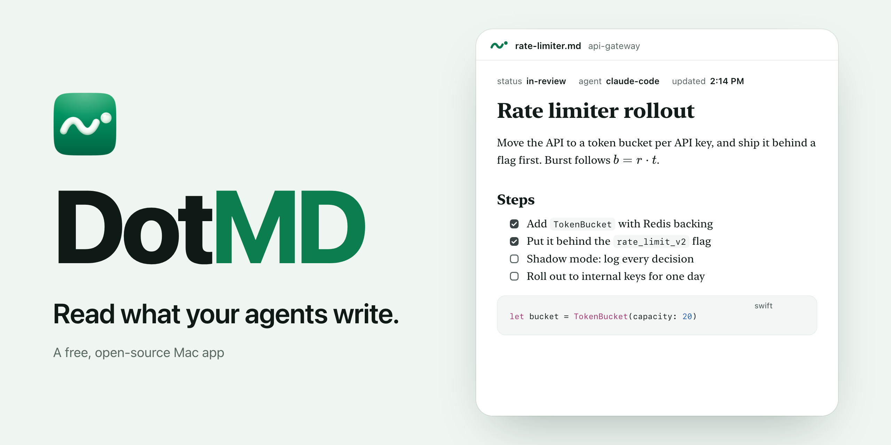

<picture>
  <source media="(prefers-color-scheme: dark)" srcset=".github/assets/cover-dark.png">
  
</picture>

# DotMD

DotMD is Preview for Markdown, with a review desk for what AI agents write. Open any `.md` file and read it rendered, the way it was meant to look. Point it at the folders where Claude Code, Codex, or Cursor work, and it shows what's new, marks what changed since you last read a file, and sends your comments back to the agent.

DotMD is a free, open-source, native Mac app. It's in early development, and there's no release yet.

## What it does

- **Reads Markdown well:** GitHub Flavored Markdown, code with highlighting, Mermaid diagrams, math, front matter, alerts, and task lists, in New York, SF Pro, or SF Mono.
- **Shows what agents wrote:** a list of your watched folders with unread files marked, and a live indicator while an agent is writing.
- **Marks changes:** what changed since you last read a file, marked in the page like an editor marks a proof. No git needed.
- **Sends comments back:** select text, comment, and send your notes to the agent as a prompt.
- **Fits the Mac:** Quick Look previews in Finder, PDF and HTML export, keyboard shortcuts, and light and dark mode.

## Build from source

You need macOS 15 or later, Xcode 27, XcodeGen, and Node 22.

```
brew install xcodegen
git clone https://github.com/dotbrainhq/dotmd.git
cd dotmd
xcodegen generate
xcodebuild -project DotMD.xcodeproj -scheme DotMD -configuration Debug -derivedDataPath build build
open build/Build/Products/Debug/DotMD.app
```

The renderer that draws documents is a small Node project in `renderer/`. Its built output is checked in, so you only need Node when you change it:

```
cd renderer
npm install
npm test
npm run build
```

## Quick Look

Select a Markdown file in Finder and press Space to preview it with DotMD. macOS shows one preview per file type, so if another app such as Obsidian also previews Markdown, its preview may open instead. To use DotMD's, open System Settings > General > Login Items & Extensions > Quick Look and turn off the other app's extension.

## Project layout

| Path | What it is |
|---|---|
| `App/` | The SwiftUI app: windows, toolbar, settings. |
| `Packages/DotMDCore/` | Logic with no UI, like watching files. |
| `Packages/DotMDRender/` | The document view, the bridge to the renderer, and export. |
| `QuickLook/` | The Finder Quick Look extension. |
| `renderer/` | The Markdown renderer that runs inside the document view. |
| `fixtures/` | Sample documents for checking the renderer by hand. |

## Contributing

See [CONTRIBUTING.md](CONTRIBUTING.md). To report a security issue, see [SECURITY.md](SECURITY.md).

## License

The code is released under the [MIT License](LICENSE). The DotMD name and the DotMD icon are not covered by the license, so please use your own name and icon if you ship a copy.
