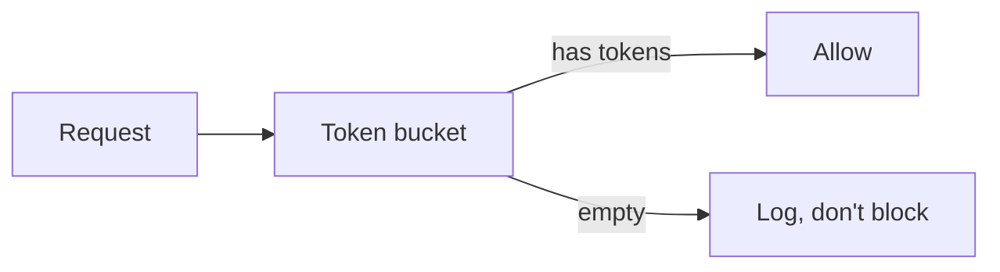

# Rate limiter rollout

Move the API from a fixed per-IP limit to a token bucket per API key. It costs $5 and $10 per month, and the bucket follows $r = n / t$.

> [!NOTE]
> Ship it behind a flag first.

## Steps

- [x] Add `TokenBucket` with Redis backing
- [ ] Shadow mode: log every decision, block nothing
- [ ] Roll out to internal keys for one day[^1]

```swift
let bucket = TokenBucket(capacity: 20, refillPerSecond: 5)
```



| Plan | Burst |
|---|---|
| Free | 20 |
| Pro | 100 |

[^1]: Internal keys are the ones owned by the team.

See the [design notes](https://example.com/notes).
